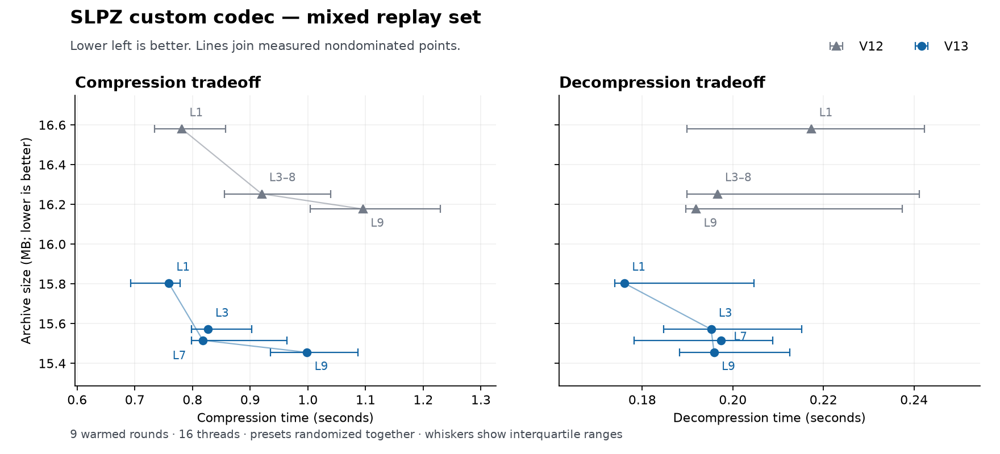

# Custom codec Pareto improvements — v13

V13 improves archive size, compression time, and decompression time on every
measured level-3 set relative to v12 (`c957ba9`). The old binary was rerun
alongside the candidate: comparisons below do not use historical timings.

Apple M4 Max, 16 threads, `-O3`, nine warmed repetitions, randomized backend
order. Times include process startup and input reading. Decode uses `slpz t`,
including reconstruction and excluding output-file writes. Every source-file
hash was verified. Desktop workload varied and was heavier than during the
v12 report; no compilation or fuzzing ran alongside the final timing rounds.

## Level 3: all three dimensions improve

| Dataset | Smaller archive | Less encode time | Less decode time |
|---|---:|---:|---:|
| Summit sample (140) | 6.63% | 6.70% | 5.03% |
| GOML + Bair mixed (103) | 4.19% | 3.79% | 5.24% |
| Additional Summit (279) | 7.23% | 7.95% | 13.35% |

Total archive bytes fall from **69,742,171 to 65,307,402** (6.36% smaller).
These are measured medians, not guarantees for every machine or corpus.

| Dataset | Codec | Archive bytes | Encode seconds | Decode seconds |
|---|---|---:|---:|---:|
| Summit sample (140) | previous_custom | 19,164,566 | 0.4512 | 0.1479 |
| Summit sample (140) | tuned | 18,326,563 | 0.4600 | 0.1746 |
| Summit sample (140) | custom | 17,894,563 | 0.4210 | 0.1405 |
| GOML + Bair mixed (103) | previous_custom | 16,253,126 | 0.4073 | 0.1347 |
| GOML + Bair mixed (103) | tuned | 15,501,178 | 0.4436 | 0.1580 |
| GOML + Bair mixed (103) | custom | 15,571,355 | 0.3919 | 0.1277 |
| Additional Summit (279) | previous_custom | 34,324,479 | 0.8390 | 0.2802 |
| Additional Summit (279) | tuned | 33,012,163 | 0.8464 | 0.2981 |
| Additional Summit (279) | custom | 31,841,484 | 0.7723 | 0.2427 |

The corpus contains 521 replays and one provenance TSV, totaling
1,309,561,719 source bytes. All three sets have been examined during this
research; the additional Summit files are not an unseen holdout. No model
uses filenames, tournament identities, or pretrained corpus tables.

## Presets and Pareto plots

The joint preset experiment in `pareto-mixed.json` interleaves all old/new
custom presets in one randomized schedule. V12 levels 3–8 use the same
policy, represented by level 3. V13 offers levels 1–2 (two candidates),
3–5 (four candidates), 6–8 (eight), and 9+ (24).

The plotted horizontal whiskers are the interquartile range of the timing
samples. Presets with overlapping timings should not be ranked confidently
on small timing differences. This plot describes the custom-codec frontier;
it does not assert superiority over every general-purpose codec.

Desktop load rose during this joint run: level-3 encode medians were
0.9199/0.8264 seconds for v12/v13, versus 0.4073/0.3919 in the paired default
run above. The wide timing ranges prevent a reliable speed ranking of nearby
presets. In particular, level-9 decode medians were 0.1919/0.1959 seconds;
this run does not establish a decode-speed improvement at every preset.

Separate paired preset runs at levels 1/7/9 are retained in their JSON files.
The level-1 encode-time difference in that run was effectively zero; the
claim of a clear win on all three datasets concerns the default level 3.

## Fair external-codec comparison

Tuned receives the same v13 numeric predictors, RNG acceleration, and
container-side changes. Custom still invokes no external payload compressor.
At level 3 it is smaller than tuned on both Summit sets and 0.45% larger on
mixed, while its measured encode and decode medians are lower on all three.

At mixed level 9, custom is 15,455,081 bytes versus tuned's 14,505,891
(6.54% larger), with encode times 0.3944 vs 2.1967 seconds
and decode times 0.1246 vs 0.1542 seconds. High-compression LZMA
still wins on size; that limitation remains open.

## Single-thread confirmation

Five warmed mixed-set repetitions at level 3, one thread:

| Codec | Encode seconds | Decode seconds |
|---|---:|---:|
| V12 custom | 2.1861 | 0.5582 |
| V13 custom | 2.0519 | 0.4835 |

V13 takes 6.14% less encode time and 13.39% less decode time,
with the same 4.19% archive reduction. See `single-mixed.json`.

## Changes responsible

- Signed modular bit differences with zigzag mapping replace XOR position
  residuals. Older records without velocity use exact previous-position bits;
  newer records retain the velocity prediction. Selected numeric fields also
  use first differences. Every 32-bit pattern remains reversible.
- RNG distances use the low 13-bit cycle to identify a candidate, then verify
  the full state with an affine jump. Decoding jumps directly as well. The
  stored step counts and exception framing are unchanged.
- Presence coding reuses neighbor loads across four two-bit symbols. LZ
  decoding skips semantic-label construction for channels that do not use
  those labels; stride-one indexing avoids unnecessary division.
- Direction-specialized predictors and clearing only touched entity keys
  reduce work in the record path. A four-candidate middle search tier recovers
  encoding time while the predictors keep the archive smaller than v12.

Both tuned and custom write v13. V9/v10/v11/v12 archives remain readable;
older readers reject v13. Legacy remains the default v9 writer. The rANS,
match, presence, and dictionary payload formats themselves are unchanged;
`CUSTOM_FORMAT.md` describes the new predictor semantics.

## Experiments and remaining opportunities

`exploratory-results.json` retains preliminary runs with their original sample
counts. Some preliminary runs overlapped compilation or changing desktop
load; they are size studies and debugging evidence, not final speed claims.

- Applying numeric prediction to every candidate field worsened size. The
  field sweep retained offsets 21/25/60/64. Second differences were worse
  than first differences in that sweep. The large subsequent gain came from
  extending position prediction to the older 51-byte records.
- Simply copying literal/context runs in bulk did not give a clear end-to-end
  win. The final implementation instead uses fast stride-one indexing and
  avoids constructing semantic labels when the serialized model ignores them.
- Enlarging the match hash table to 128K/256K/512K entries gave negligible
  size gains or regressions and increased setup cost. The 64K cap remains.
- On 533 mask blocks captured from v12, the existing two-bit conditional
  representation used 3,067,144 bytes; byte-context coding and bit-run variants
  used roughly 3.42–4.09 MB, despite faster encoding in several cases. Some
  individual blocks preferred alternatives. `mask-micro.cpp` retains that
  encoder-only probe; its input dump is `u32 count, u32 plane_count, profile
  bytes, reference bytes, original packed masks`, under `build/round3-mask-data`.
  Those local dumps are not checked in. Re-evaluating mask choices after the
  new numeric predictors remains a useful direction.

## Validation

- All 522 benchmark files match their decoded hashes.
- `make check`: original selftest, 3,430 payload checks, 111,292 record checks,
  and 2,118,231 predictor/RNG checks. Archive hash/extraction checks cover
  all backends at levels 1/3/7/9, nine fixtures, and older/short post records.
- ASan/UBSan pass on payload and predictor tests. RNG tables are checked
  against the scalar stepper across the full low-bit cycle, every distance
  through/beyond the search cap, random seeds, and unrelated/aliased states.
- Native/scalar custom archives are byte-identical; both readers check both
  against 140 source hashes. V9 (419 files), v10 custom/tuned, v11, and v12
  custom/tuned compatibility checks pass. V9/v11/v12 readers reject v13.
- A build with fatal zstd/LZMA/brotli encoder tripwires produces the exact
  mixed custom archive. The standalone payload codec links none of them.
- Custom libFuzzer + ASan/UBSan: 45,248 runs in 61 seconds, no findings; peak reported RSS 533 MB.
- Predictor libFuzzer + ASan/UBSan: 55,212 runs in 61 seconds, no findings; peak reported RSS 455 MB.

These are smoke runs, not sustained fuzzing campaigns. Detailed evidence is
in `validation.json`; generated data, corpora, and binaries remain ignored.

## Reproduction

Build the previous custom binary separately from commit `c957ba9`.

The historical driver and its command-line options are archived at commit
`5cdb2bf`: [compare_custom.py](https://github.com/Eppie/slippack/blob/5cdb2bf/benchmarks/compare_custom.py), [compare_presets.py](https://github.com/Eppie/slippack/blob/5cdb2bf/benchmarks/compare_presets.py).

All timing samples, binary hashes, and input-list hashes are retained in JSON.
See `fuzz/README.md` for the sanitizer fuzz targets.
The plot can be regenerated with `python3 benchmarks/2026-11-08-v13/plot_pareto.py`
in an environment with matplotlib installed; it is not a codec dependency.
